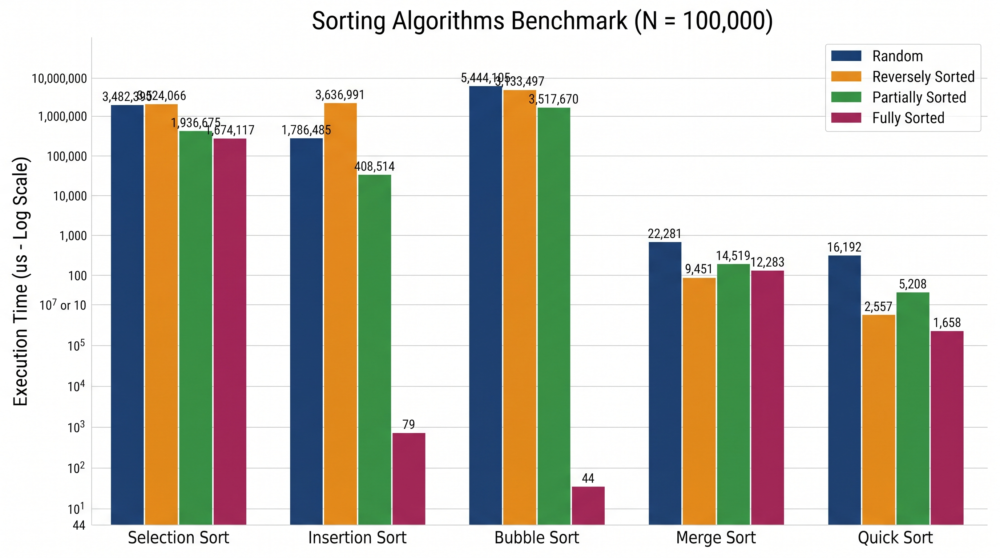

# Sorting Algorithms Benchmark 

## 1. البيانات الشخصية
- **اسم الطالب:** سلسبيل عبد الله البراني
- **الرقم القيد:** 3166174
- **المجموعة:** C

---

## 2. جدول نتائج القياس الزمني (حجم البيانات $N = 100,000$)

تم إجراء القياسات بوحدة الميكروثانية ($\mu s$) باستخدام `System.nanoTime()` مع أخذ نسخة مستقلة لكل خوارزمية:

| الخوارزمية | غير مرتبة  | مرتبة عكسياً  | مرتبة جزئياً  | مرتبة تماماً  |
| :--- | :---: | :---: | :---: | :---: |
| **Selection Sort** | `3,482,399` $\mu s$ | `3,524,066` $\mu s$ | `1,936,675` $\mu s$ | `1,674,117` $\mu s$ |
| **Insertion Sort** | `1,786,485` $\mu s$ | `3,636,991` $\mu s$ | `408,514` $\mu s$ | `79` $\mu s$ |
| **Bubble Sort** | `5,444,105` $\mu s$ | `5,133,497` $\mu s$ | `3,517,670` $\mu s$ | `44` $\mu s$ |
| **Merge Sort** | `22,281` $\mu s$ | `9,451` $\mu s$ | `14,519` $\mu s$ | `12,283` $\mu s$ |
| **Quick Sort** | `16,192` $\mu s$ | `2,557` $\mu s$ | `5,208` $\mu s$ | `1,658` $\mu s$ |

---

## 3. الرسم البياني للمقارنة (Performance Chart)

---

## 4. تحليل ومناقشة النتائج

### أ. مقارنة الفرق في الأداء بين خوارزميات $O(N^2)$ وخوارزميات $O(N \log N)$
- **الفجوة الزمنية الهائلة:** عند حجم بيانات $N = 100,000$، يصل عدد العمليات التقريبي في الخوارزميات التربيعية $O(N^2)$ مثل (Selection, Bubble, Insertion) في الحالات العشوائية والعكسية إلى نحو $10^{10}$ عملية (10 مليارات عملية مقارنة/تبديل)، مما يجعل زمن تنفيذها يقاس بالثواني (من `1.78` ثانية في Insertion Sort إلى `5.44` ثانية في Bubble Sort).
- في المقابل، الخوارزميات اللوغاريتمية O(N \log N) مثل (Merge Sort و Quick Sort) تعتمد على مبدأ **فرّق تسد (Divide and Conquer)**، حيث يبلغ عدد العمليات التقريبي $100,000 \times \log_2(100,000) \approx 1.66 \times 10^6$ عملية فقط، ولذلك تنهي عملها في أجزاء من الثانية (`16,192` إلى `22,281` ميكروثانية فقط).
- **تأثر الخوارزميات بالحالة الابتدائية:**
  * **Selection Sort:** غير حساسة لحالة البيانات من حيث التعقيد؛ تعقيدها دائماً $\Theta(N^2)$ في جميع الحالات لأنها تبحث عن أصغر عنصر في باقي المصفوفة في كل دورة بغض النظر عن ترتيبها (تراوح زمنها بين `1.67` و `3.52` ثانية).
  * **Merge Sort:** ثابتة الأداء (O(N \log N)) في جميع الحالات (`9,451` إلى `22,281` $\mu s$) لأنها تقسم المصفوفة دائماً إلى نصفين متساويين وتدمجهما، ولكنها تستهلك ذاكرة إضافية $O(N)$.

### ب. الخوارزمية الأفضل في حالة البيانات المرتبة والمرتبة جزئياً مع التعليل
1. **في حالة البيانات المرتبة تماماً (Fully Sorted):**
   * **الأفضل:** خوارزمية **Bubble Sort المحسنة** (`44` $\mu s$) المزودة بمتغير `swapped`، وخوارزمية **Insertion Sort** (`79` $\mu s$).
   * **التعليل:** يتحول التعقيد الزمني لخوارزمية Insertion Sort و Bubble Sort المحسنة في أفضل حالاتهما (Best Case) إلى خطي $O(N)$؛ ففي Insertion Sort يفشل الشرط الداخلي (`arr[j] > key`) من أول مقارنة في كل خطوة، وفي Bubble Sort لا يحدث أي تبديل في الدورة الأولى فتتوقف فوراً بعد $N-1$ مقارنة فقط، متفوقتين حتى على Merge Sort (`12,283` $\mu s$) و Quick Sort (`1,658` $\mu s$) اللتين تقومان بعمليات التقسيم والاستدعاء الذاتي في جميع الأحوال.
2. **في حالة البيانات المرتبة جزئياً (Partially Sorted):**
   * **الأفضل على الإطلاق (عند $N=100,000$):** خوارزميتا **Quick Sort** (`5,208` $\mu s$) و **Merge Sort** (`14,519` $\mu s$) بسبب حجم البيانات الكبير ووجود 20% عشوائية كاملة.
   * **الأفضل ضمن فئة $O(N^2)$:** خوارزمية **Insertion Sort** (`408,514` $\mu s$) تتفوق بفارق شاسع على Selection (`1,936,675` $\mu s$) و Bubble (`3,517,670` $\mu s$)؛ لأن زمن تنفيذها يتناسب طردياً مع عدد الانقلابات (Inversions) في المصفوفة $O(N + d)$ حيث $d$ عدد العناصر غير المرتبة. كلما اقتربت المصفوفة من الترتيب، اقترب أداؤها من $O(N)$.

### ج. تفسير سلوك خوارزمية Quick Sort في الحالة العكسية / المرتبة تماماً وتأثير عنصر المحور (Pivot)
- **المشكلة النظرية والعملية (Worst Case O(N^2)):**
  إذا كانت خوارزمية Quick Sort تختار **أول عنصر** أو **آخر عنصر** كمحور (Pivot)، وتم تمرير مصفوفة **مرتبة تماماً** أو **مرتبة عكسياً**، فإن عملية التقسيم (Partitioning) ستكون غير متوازنة إطلاقاً؛ حيث ينقسم الجزء إلى قسم فارغ ($0$ عنصر) وقسم يحتوي على باقي العناصر ($N-1$ عنصر).
- **الأثر على الأداء والذاكرة:**
  1. يتدهور التعقيد الزمني من $O(N \log N)$ إلى الحالة الأسوأ **$O(N^2)$**.
  2. يصل عمق شجرة الاستدعاء الذاتي (Recursion Tree Depth) إلى $N$ استدعاء متتالي بدلاً من $\log N$، وعند $N = 100,000$ في لغة Java يؤدي ذلك إلى امتلاء ذاكرة المكدس وتوقف البرنامج بخطأ **`java.lang.StackOverflowError`**.
- **الحل البرمجي المتبع:**
  لتفادي هذا التدهور في الحالة المرتبة والعكسية، تم اختيار المحور ليكون **العنصر الأوسط** (`mid`). اختيار العنصر الأوسط في مصفوفة مرتبة أو عكسية يقسم المصفوفة إلى نصفين متساويين تماماً في كل خطوة، مما جعل أداءها في الحالة المرتبة (`1,658` $\mu s$) والعكسية (`2,557` $\mu s$) يحقق أفضل أداء ممكن $O(N \log N)$.
